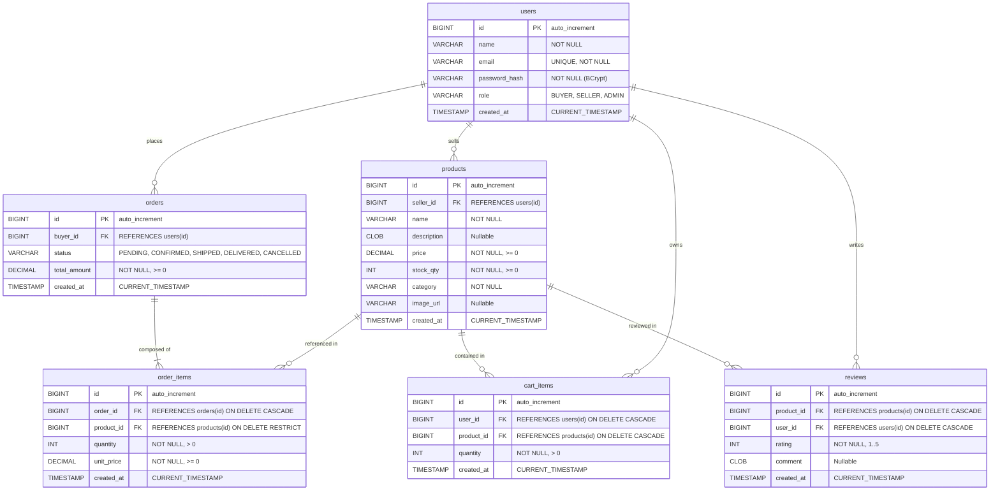
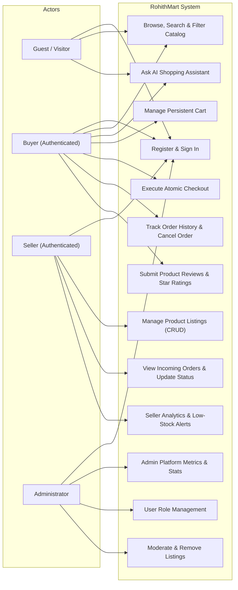

# System Diagrams

This document contains native GitHub-rendered Mermaid diagrams matching the actual implementation of **RohithMart**.

---

## 1. Entity-Relationship (ER) Diagram



---

## 2. Use Case Diagram



---

## 3. Place Order Sequence Diagram (10-Step Transactional Checkout)

```mermaid
sequenceDiagram
    autonumber
    actor Buyer as Buyer
    participant Browser as Browser (JSP/JS)
    participant Filter as CsrfFilter & AuthFilter
    participant Servlet as CheckoutServlet
    participant OrderService as OrderService
    participant CartDAO as CartItemDAO
    participant ProductDAO as ProductDAO
    participant OrderDAO as OrderDAO
    participant DB as H2 Database (HikariCP)

    Buyer->>Browser: Clicks "Confirm & Place Order"
    Browser->>Filter: POST /checkout/place (_csrf, Session Cookie)
    Filter->>Filter: Verify active BUYER session & CSRF token
    Filter->>Servlet: Forward authenticated request
    Servlet->>OrderService: checkout(buyerId)

    Note over OrderService,DB: 1. Load Cart & Validate Inventory
    OrderService->>CartDAO: findByUserId(buyerId)
    CartDAO->>DB: SELECT * FROM cart_items WHERE user_id = ?
    DB-->>CartDAO: cartItems
    CartDAO-->>OrderService: cartItems

    loop For each cart item
        OrderService->>ProductDAO: findById(productId)
        ProductDAO->>DB: SELECT * FROM products WHERE id = ?
        DB-->>ProductDAO: product
        ProductDAO-->>OrderService: product (reload current price & stock)
    end

    Note over OrderService,DB: 2. Begin Atomic Database Transaction
    OrderService->>DB: Connection conn = ds.getConnection(); conn.setAutoCommit(false)

    Note over OrderService,DB: 3. Create Order Header
    OrderService->>OrderDAO: createOrder(conn, order)
    OrderDAO->>DB: INSERT INTO orders (buyer_id, status, total_amount) VALUES (...)
    DB-->>OrderDAO: generated orderId

    Note over OrderService,DB: 4. Create Order Items & Deduct Inventory
    loop For each cart item
        OrderService->>OrderDAO: createOrderItem(conn, item)
        OrderDAO->>DB: INSERT INTO order_items (...) VALUES (...)
        OrderService->>ProductDAO: deductStock(conn, productId, qty)
        ProductDAO->>DB: UPDATE products SET stock_qty = stock_qty - ? WHERE id = ? AND stock_qty >= ?
    end

    Note over OrderService,DB: 5. Clear Cart & Commit Transaction
    OrderService->>CartDAO: clearCart(conn, buyerId)
    CartDAO->>DB: DELETE FROM cart_items WHERE user_id = ?
    OrderService->>DB: conn.commit()
    OrderService-->>Servlet: OrderDTO (Created Order Details)

    Servlet-->>Browser: HTTP 302 Redirect to /buyer/orders
    Browser-->>Buyer: Render Order History with Confirmation Toast
```

---

## 4. Layered Architecture Diagram

```mermaid
flowchart TD
    subgraph Client["Presentation & Client Layer"]
        UI["JSP Views (JSTL 1.2, Semantic HTML5, CSS Variables, Vanilla JS)"]
        REST["REST API Consumers (JSON / Fetch)"]
    end

    subgraph Security["Filter & Interceptor Layer"]
        EF["EncodingFilter (UTF-8)"]
        SHF["SecurityHeadersFilter (CSP, X-Frame-Options, X-Content-Type)"]
        LF["LoggingFilter (MDC Correlation ID)"]
        CF["CsrfFilter (Token Verification on POST/PUT/DELETE)"]
        AF["AuthFilter (Session Verification & Role-Based Access Control)"]
    end

    subgraph Web["Controller / Servlet Layer"]
        AuthS["AuthServlet / AuthApiServlet"]
        ProdS["ProductServlet / ProductApiServlet"]
        CartS["CartServlet / CartApiServlet"]
        CheckS["CheckoutServlet"]
        OrderS["BuyerOrderServlet / OrderApiServlet"]
        SellS["SellerDashboardServlet / SellerApiServlet"]
        AdminS["AdminDashboardServlet / AdminApiServlet"]
        ChatS["ChatServlet"]
    end

    subgraph Service["Service Layer (Business Logic & Transactions)"]
        AuthService["AuthService (BCrypt verification, session security)"]
        ProductService["ProductService (Catalog, search, validation, batch stats)"]
        CartService["CartService (Stock validation, authoritative price calculation)"]
        OrderService["OrderService (10-step atomic checkout, order lifecycle)"]
        ReviewService["ReviewService (Eligibility checks, duplicate prevention)"]
        UserService["UserService (Profile updates, role management)"]
        ChatService["ChatService (Rate limiting, session caching, fallback)"]
    end

    subgraph DAO["Data Access Object (DAO) Layer"]
        UserDAO["UserDAO"]
        ProductDAO["ProductDAO"]
        CartDAO["CartItemDAO"]
        OrderDAO["OrderDAO & OrderItemDAO"]
        ReviewDAO["ReviewDAO"]
    end

    subgraph Persistence["Persistence & Connection Infrastructure"]
        CP["HikariCP Connection Pool (Owned by AppContextListener)"]
        DB[("H2 Database (AUTO_SERVER=TRUE / Embedded / In-Memory)")]
    end

    Client --> Security
    Security --> Web
    Web --> Service
    Service --> DAO
    DAO --> CP
    CP --> DB
```


